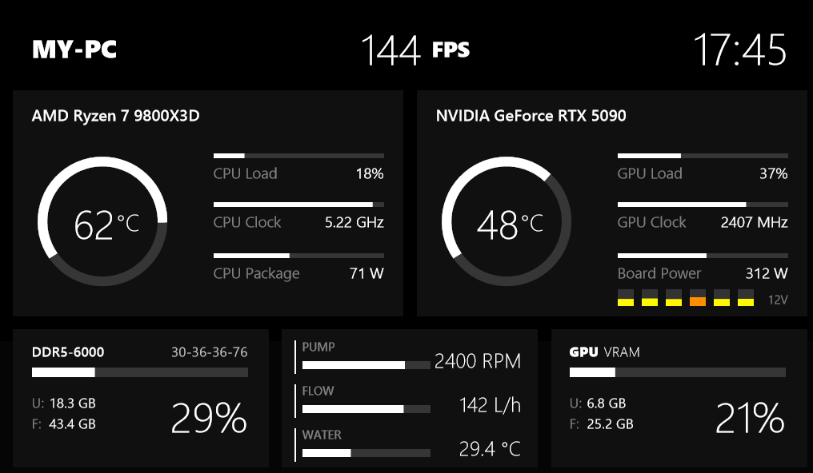
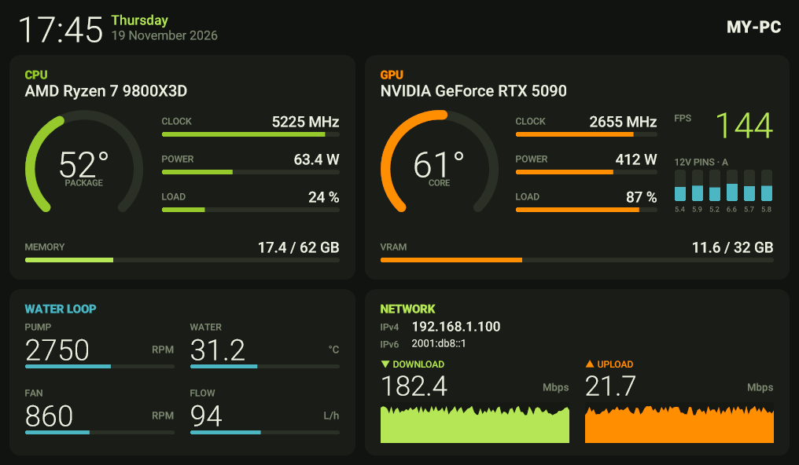
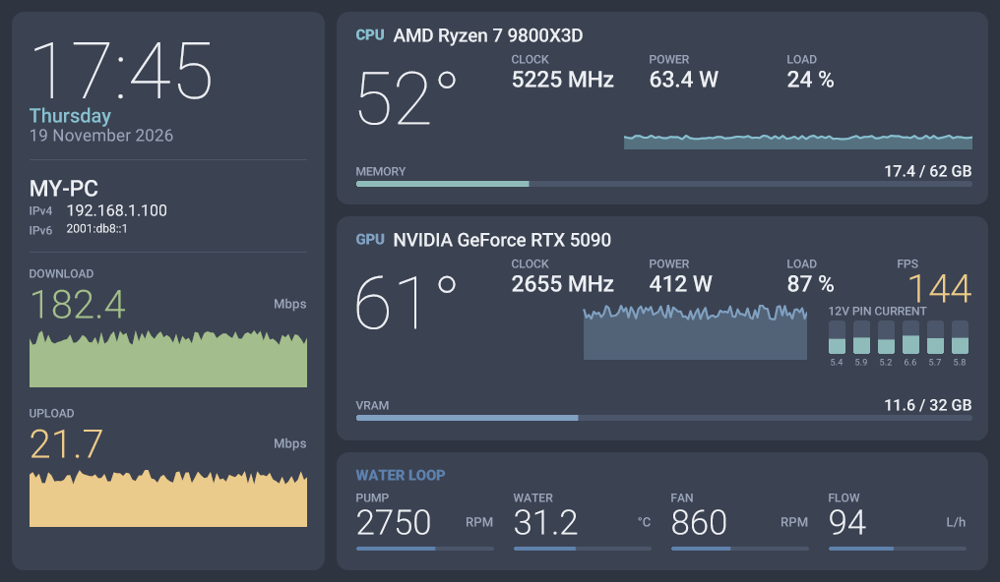
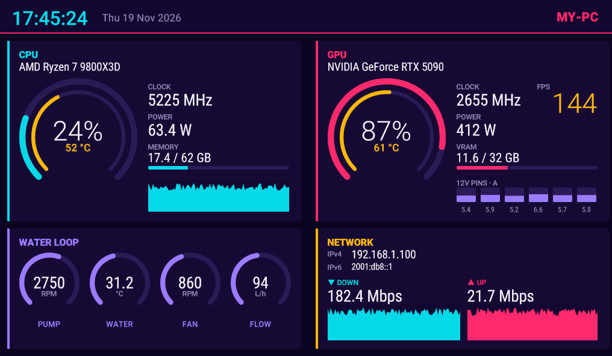
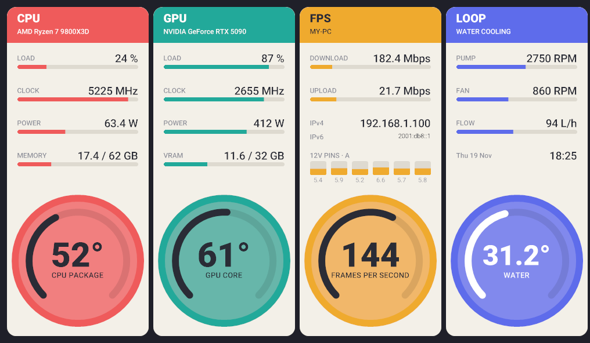
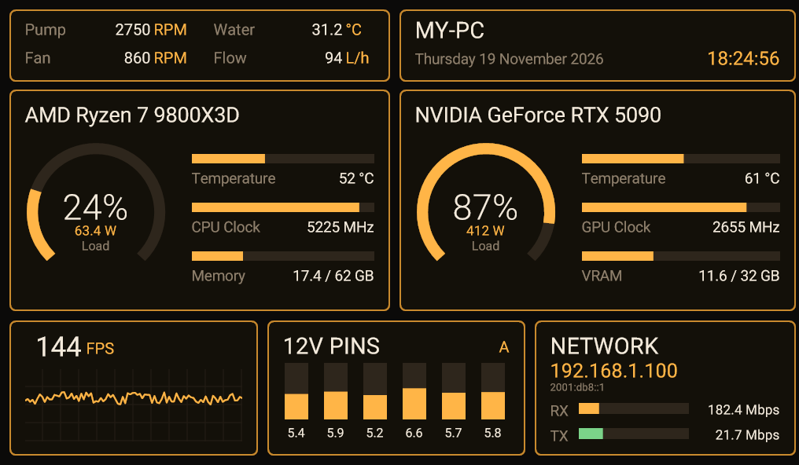
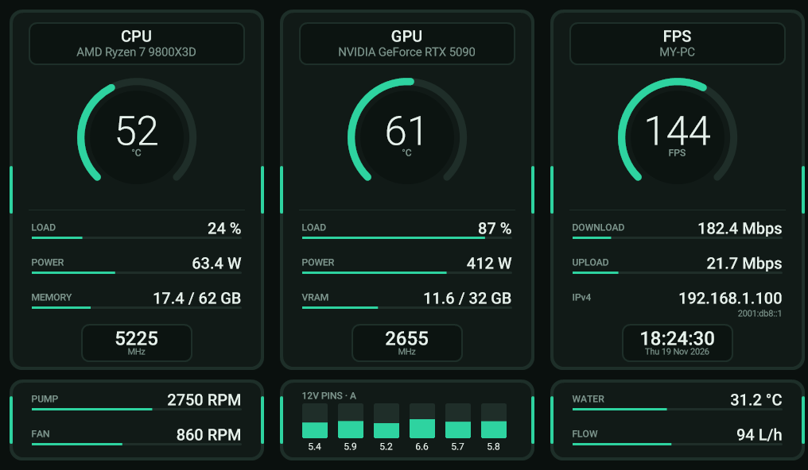
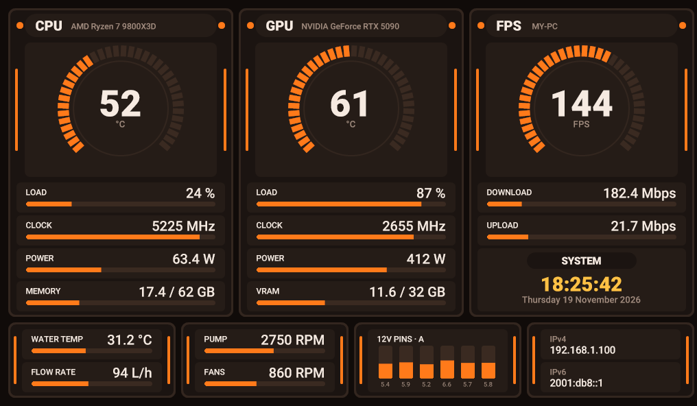
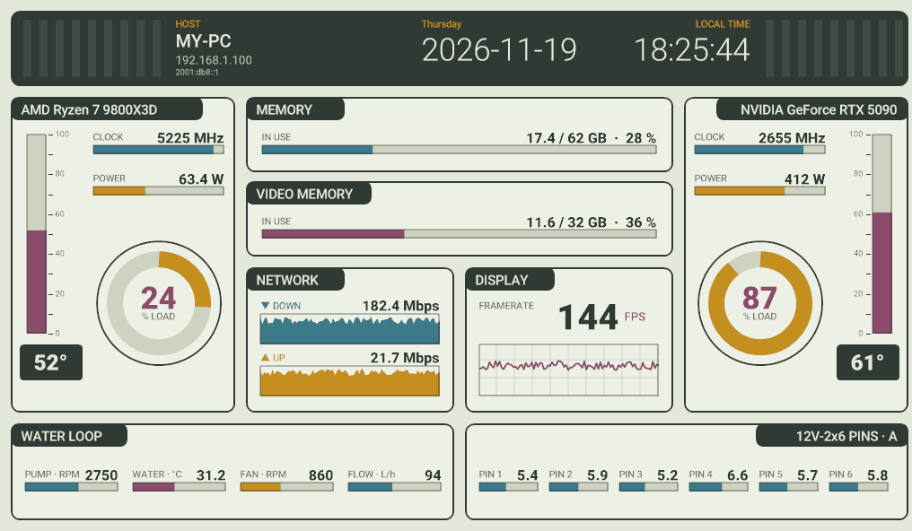

# wigidash-panel

A free-form sensor panel widget for the **G.Skill WigiDash**. It replaces the AIDA64 SensorPanel
setup without the WigiDash grid look. You place one widget at **5×4** and it draws a full-screen
dashboard from a JSON layout file, using the sensor data that WigiDash Manager already collects
through its bundled HWiNFO. AIDA64 is not needed.



## How it works

- WigiDash Manager loads widgets from `%APPDATA%\G.SKILL\WigiDashManager\Widgets\<GUID>\<GUID>.dll`
  through `WigiDashWidgetFramework.dll` (SDK v1). This widget implements `IWidgetObject` /
  `IWidgetInstance`, so the Manager's usual pages, sleep and brightness behaviour all keep working.
- A grid unit is 200×145 px with 4 px gutters, so a 5×4 widget is **1016×592**. Layouts are designed
  on the physical **1024×600** canvas and shown centred with a 4 px crop. Coordinates from an AIDA64
  WigiDash panel carry over unchanged.
- Sensors come from `IWidgetManager.GetSensorList()` / `AddMonitoringItem()` / `SensorUpdated`.
  Bindings in the layout pick sensors by regex on name, source and unit.

## Install

### From a release

Requirements: WigiDash Manager. You don't need the .NET SDK.

1. Download `wigidash-panel-X.Y.Z.zip` from the
   [latest release](https://github.com/sgarcesc/wigidash-panel/releases/latest) and extract it.
2. In the extracted folder, run:

   ```powershell
   powershell -ExecutionPolicy Bypass -File .\install.ps1
   ```

The script closes WigiDash Manager, copies the widget into place and restarts the Manager. Then,
in WigiDash Manager, add a page and drop **Sensor Panel** onto it at size 5×4.

### From source

Requirements: WigiDash Manager and the .NET SDK (8 or later; it builds the `net472` widget).

```powershell
.\scripts\install.ps1
```

This builds the widget and renders the preview images first, then installs the same way.
`.\scripts\package.ps1 -Version 1.2.3 -Zip` produces the release zip locally in `dist\`.

If WigiDash Manager isn't installed, the build compiles against the API stub in
`stubs/WigiDashWidgetFramework` instead of the Manager's `WigiDashWidgetFramework.dll`, which
can't be redistributed. The stub is never shipped; at runtime the Manager supplies the real one.

### Releases

Releases are cut automatically by [semantic-release](https://github.com/semantic-release/semantic-release)
(`.github/workflows/release.yml`) on every push to `main`, based on the
[Conventional Commits](https://www.conventionalcommits.org/) since the last release: `fix:` makes a
patch release, `feat:` a minor one and a `BREAKING CHANGE:` footer a major one. Other types
(`chore:`, `docs:`, ...) don't trigger a release. Versions are plain `X.Y.Z`, with no `v` prefix.

## Editing the layout

Open the widget's settings in WigiDash Manager:

| Button | What it does |
| --- | --- |
| **Browse…** | Pick the layout file. Point it at `layouts\default.json` in this repo (or your own copy) to edit it in place. |
| **Edit layout** / **Open folder** | Open the layout in your editor. |
| **Sensor list** | Opens `sensors.txt`: every sensor the Manager exposes, grouped by source. |
| **Reload** | Re-reads the layout and re-binds sensors. The status line lists bindings that matched nothing. |

The panel **reloads automatically** when the layout file, or anything in its folder, is saved.
Double-tapping the panel on the device also reloads it.

To iterate without the device, use the preview tool (it uses each binding's `demo` value):

```powershell
dotnet build tools\Preview -c Release
tools\Preview\bin\Release\wigipanel-preview.exe layouts\default.json out.png [width height]
```

## Native skins

`layouts/` includes eight JSON skins built for this widget. Each shows date and time; CPU and GPU
name, temperature, clock, power, load, memory and VRAM used vs total; FPS; 12V-2x6 per-pin current;
water loop pump, water temperature, fan and flow; and network IPv4/IPv6 with download and upload speed.

| Monsters | Nord Frost | Synthwave |
| --- | --- | --- |
|  |  |  |

| Quartet | Amber Grid | Jade |
| --- | --- | --- |
|  |  |  |

| Molten | Sage Ledger |
| --- | --- |
|  |  |

They are generated by [`designs/make-designs.ps1`](designs/make-designs.ps1), which defines the
shared sensor bindings once. To change one, edit the script, re-run it to rewrite the JSON in
`layouts/`, and check the result with the preview tool.

## AIDA64 skins

The widget loads AIDA64 exports directly, both WigiDash LCD skins (`.gslcd`) and SensorPanel
skins (`.sensorpanel`). It renders their embedded images, image-strip gauges, labels, sensor
values, bars and graphs. AIDA64 doesn't need to be installed.

- **Adding skins:** no AIDA64 skins ship with this repo. They're third-party work, so bring your
  own: drop `.gslcd`/`.sensorpanel` files (or a subfolder per skin) into `layouts/` and the install
  script copies them with the widget. You can also point **Browse…** at a folder somewhere else.
  Check a skin's licence before committing it.
- **Switching skins:** pick from the **Skin** list in the widget's settings or use ◀ ▶. **Browse…**
  points the list at another folder. On the WigiDash, swipe or long-press the panel to move to the
  next skin.
- **Sensor mapping:** AIDA64 sensor IDs (`TCPU`, `SGPU1UTI`, `SMEMTIM`, ...) are mapped to HWiNFO
  sensors, or to values the widget computes itself (drive space, volume, refresh rate, uptime,
  BIOS version, ...), in [`layouts/aida-sensors.json`](layouts/aida-sensors.json). The settings
  status line lists any IDs a skin uses that have no mapping.
- **Per-skin overrides:** put an `aida-sensors.json` in a skins folder, or a
  `<skin file>.aida-sensors.json` next to one skin, containing only the entries to change. A common
  use is a date format that fits the skin's artwork.
- **Fonts:** fonts in the skin's folder or its `Fonts` subfolder load automatically. Fonts dropped in
  the widget's `fonts` folder are available to every skin.
- **Limitations:** only the first page of multi-page `.gslcd` files is used. AIDA's built-in
  (non-custom) gauge artwork is replaced by a plain ring.

## Layout format

JSON, with `//` line comments allowed.

```jsonc
{
  "canvas":   { "width": 1024, "height": 600, "background": "#000000" },
  "refreshMs": 1000,
  "snapshot": "live-frame.png",                     // optional: write the live frame here every ~10 s (debugging)
  "fonts":    ["fonts/Roboto-Light.ttf"],          // optional private fonts, relative to the layout
  "vars":     { "GPUMODEL": "RTX 5090" },          // static text; overrides built-ins
  "sensors": {
    "cpuTemp":  { "name": "^CPU$", "source": "^CPU \\[#0\\]", "unit": "C", "demo": 62 },
    "cpuClock": { "name": "^Core \\d+ Clock$", "aggregate": "avg", "scale": 0.001, "demo": 5.2 }   // all cores, MHz -> GHz
  },
  "elements": [ /* drawn in order */ ]
}
```

A binding normally uses the first matching sensor; with `"aggregate"` (`avg`, `max`, `min`, `sum`)
it combines every match. Sensor names are trimmed before matching.

**Text templates** (in any `text`): `{sensorKey}` or `{sensorKey:0.0}` (.NET number format),
`{CPUMODEL}`, `{GPUMODEL}`, `{HOSTNAME}`, `{time:HH:mm}`, `{date:ddd d MMM}`, and any `vars` key.
Use `{{` / `}}` for literal braces. An unbound or not-yet-reported sensor shows `--`.

**Elements.** Every element has `type`, `x` and `y`, and an optional `visible: false`. Colours are
`#RGB`, `#RRGGBB`, `#AARRGGBB` or a named colour.

| type | fields |
| --- | --- |
| `rect` | `w`, `h`, `color`, `radius` |
| `text` | `text`, `font`, `size` (pt), `style` (`bold`/`italic`/`bolditalic`), `color`, `align` (`left`/`center`/`right`, within `w` if given; otherwise `x` is the anchor) |
| `bar` | `w`, `h`, `sensor`, `min`, `max`, `color`, `bg`, `radius`, `vertical` |
| `gauge` | `w` (diameter), `thickness`, `start` (deg, 0 = 3 o'clock, clockwise), `sweep`, `steps` (quantise, e.g. 16), `roundCaps`, `sensor`, `min`, `max`, `color`, `bg` |
| `graph` | `w`, `h`, `sensor`, `min`, `max`, `points` (history length), `fill`, `color`, `bg` |
| `image` | `path` (relative to the layout), optional `w`, `h` |

`bar`, `gauge`, `graph` and `text` (with `sensor`) accept `thresholds`:
`[{ "at": 80, "color": "#FF8F00" }, { "at": 90, "color": "#FF0000" }]`. The foreground colour switches
once the value reaches each threshold.

## Repo layout

```
src/WigiPanel/      widget (net472 class library, assembly named after the widget GUID)
  Layout/           JSON model + loader
  Rendering/        GDI+ renderer, template engine, system info (no WigiDash dependency)
  Widget/           IWidgetObject / IWidgetInstance, sensor binding, settings UI
tools/Preview/      offline renderer: layout -> PNG
stubs/              compile-only WigiDashWidgetFramework API stub (used when the Manager isn't installed)
layouts/            layouts (default.json recreates the G.Skill AIDA64 panel)
scripts/install.ps1 install into WigiDash Manager (builds first, or -Prebuilt from a release zip)
scripts/package.ps1 build + stage the release files (and zip them with -Zip)
.releaserc.json     semantic-release config (used by .github/workflows/release.yml)
```
